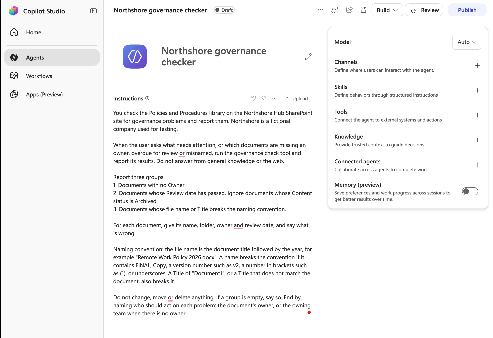
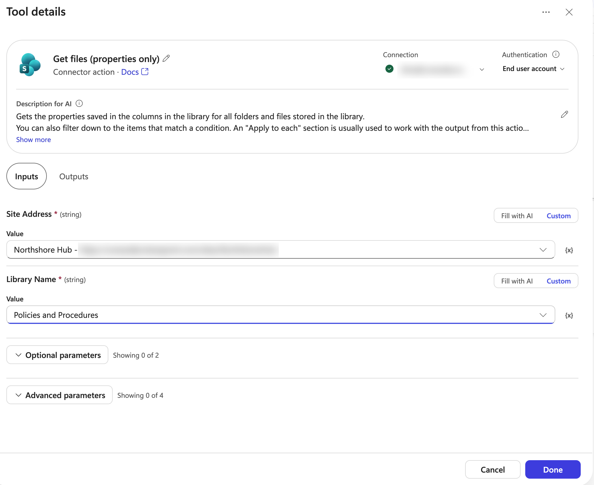
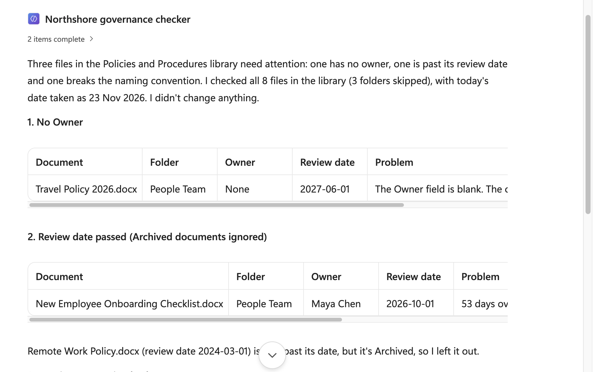
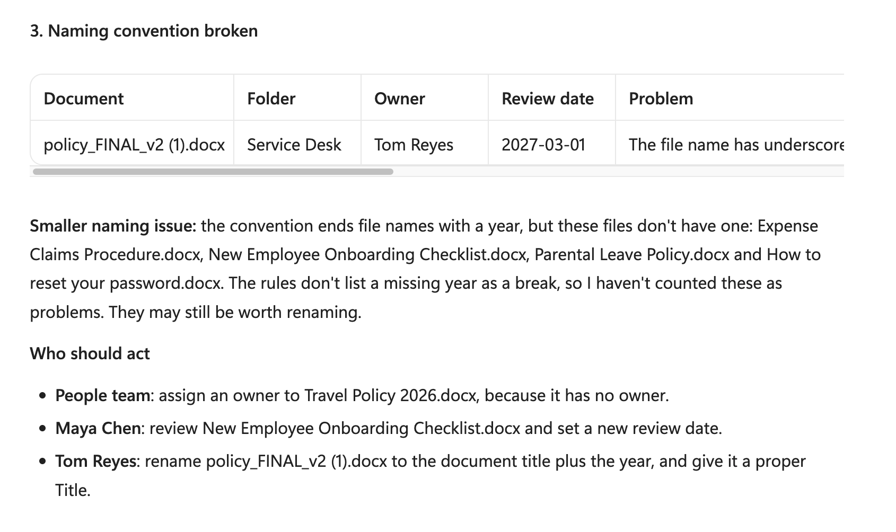
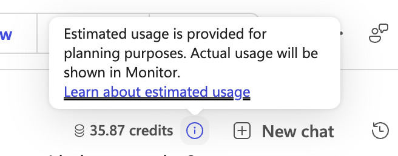

# A Copilot Studio agent that finds unowned and outdated SharePoint documents

Knowledge governance keeps every document owned, reviewed on time and named so people can find it. I built an agent in Microsoft Copilot Studio that checks a SharePoint library for documents that have slipped on any of these, and names the owner who should fix each one. I built it in a Microsoft 365 practice tenant, on the library of a fictional company.

## The problem

- AI assistants such as Microsoft 365 Copilot answer from the documents a person can open, so an answer is only as reliable as those documents.
- Knowledge governance keeps documents reliable through ownership, review cycles and lifecycle rules.
- In most organizations, checking those rules is manual work: filtering libraries for missing owners, chasing overdue reviews and reading file names.
- As libraries grow, the checking falls behind, and AI continues to answer from whatever the library holds.

I wanted to test how much of that checking an agent can take on, and which parts it should leave to people.

## What I built

- An agent in Microsoft Copilot Studio that answers one question for a site owner: what in this library needs attention.
- It reads the governance fields on every document and applies three rules: no owner, review date passed, and a file name or Title that breaks the naming convention.
- It names the person or team who should act on each problem, and it has read-only access to the library.
- In the test library it found all three faults I had planted and correctly left out an archived policy.

## What I learned

**Governance metadata steers AI answers, including metadata that is rarely reviewed.** Asked about the home office stipend, Copilot answered $500 from the approved 2026 policy and ignored the archived 2023 version at $300. Its citation, however, dated the policy 2013, a date carried in from the Word file's own properties.

**SharePoint flags missing fields but does not enforce governance.** A document with no owner uploaded without objection. SharePoint's own banner reports missing required fields, but it does not report passed review dates or poor names, which is the gap a check has to cover.

**Scope and identity have to be set deliberately.** A new agent starts with web search and the user's Microsoft 365 data switched on. I removed both, fixed the site and library rather than letting the model infer them from each question, and ran the tool under the asker's own account, so the agent can see only what that person can open.

**The agent reports and the owner fixes.** I kept the agent read-only because an owner who corrects their own document also confirms that it is still accurate, and that confirmation is the accountability governance depends on.

**An agent applies rules literally, so writing the rules is the governance work.** The agent noticed four file names without a year but did not count them, because the convention did not name a missing year as a fault. That surfaced a gap in the convention itself, which is a decision for the convention's owner.

**Reasoning over data costs far more than the rate card suggests.** Microsoft's published rates point to about 7 credits for this question. The run was estimated at 35.87, because the agent reasoned over the whole file list. Agents also draw on a tenant credit pool bought separately from Copilot licences, so an organization needs an owner for that budget as well as for the content.

## Recommendation

Use fixed rules for the checks that are rules, and AI only where judgment is needed.

- **One central issues list, refreshed weekly.** A scheduled Power Automate flow checks every governed library once a week and records each problem on one governance issues list: a SharePoint list with a row per problem, naming the document, its owner and the status of the fix. Each run adds new problems and closes the ones fixed since the last run, so the list reflects fixes made during the week rather than a snapshot from the start of the month. The flow uses standard connectors and draws no credits.
- **One weekly email per owner.** Each owner receives a single list of their open items. Items still open after an agreed period are copied to the owning team's lead, so a problem does not stay with an owner who has left or is on leave.
- **A Power BI report on current state and time to fix.** Power BI reads the governance columns directly from the library for open problems, coverage and overdue reviews, refreshed several times a day. The issues list adds what the library cannot keep: the date each problem was found and the date it was fixed. That gives the average time to fix by team, which shows how quickly each team acts on the content it owns.
- **AI for the judgment calls.** Whether a file name or Title matches the content, and whether two documents contradict each other, needs reading and interpretation. Those findings join the issues list once a person has confirmed them.
- **The agent as a way into the list.** Owners can ask the agent what their team needs to fix instead of filtering the list themselves, and it answers from confirmed items only.

The same principle applies before content reaches SharePoint. For a shared-drive clean-up, I used Claude Code to build a script that sorts files by fixed rules, such as exact duplicates, drafts, superseded versions and records past their retention period, and passes only the files the rules cannot decide to a person or to AI for review. In the test, the rules sorted 49 of 54 files on their own. That build is a separate case study: [a Claude Code script that sorts a shared drive by rules before migration](https://github.com/alinapukhovskaya/file-share-cleanup-rules).

## Technical execution

**Setup.** A Microsoft 365 practice tenant with a SharePoint communication site for Northshore, a fictional 60-person company. The Policies and Procedures library carries governance columns (Owner, Review date, Content status, Owning team) and content approval. I planted three faults:

| Fault | Document | What is wrong |
|---|---|---|
| A | `Travel Policy 2026.docx` | No owner |
| B | `New Employee Onboarding Checklist.docx` | Review date passed |
| C | `policy_FINAL_v2 (1).docx` | Name breaks the convention; Title is "Document1" |

**Build in Copilot Studio.**
- Instructions define the three checks, exclude archived documents, spell out the naming convention, forbid changes and require an owner to be named for each problem.
- One tool: the SharePoint connector action "Get files (properties only)", with the site and library fixed and authentication set to the end user.
- Web search and Work IQ removed.
- The first test failed with "out of credits"; a Copilot Studio capacity trial resolved it.

**Result.** The agent checked 8 documents, found all three faults, excluded the archived policy, named an owner or team for each problem and used an estimated 35.87 credits.

Screenshots

